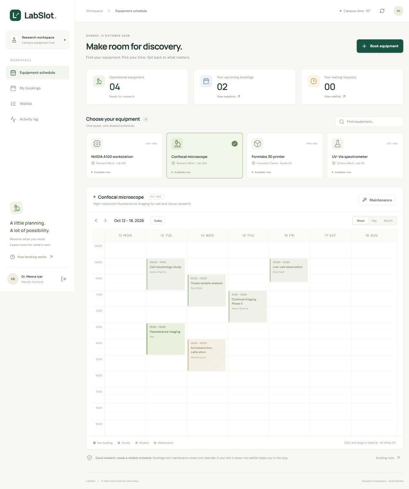
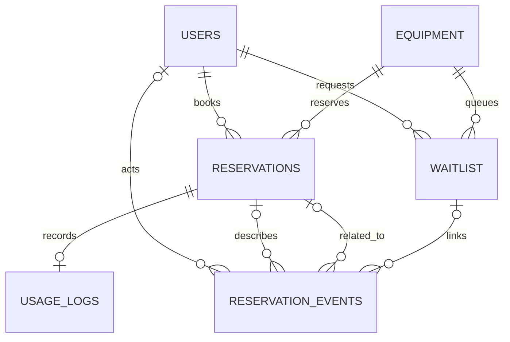

# LabSlot

A lab equipment booking system built with **Vue 3, FullCalendar, Express, and PostgreSQL**. Students and faculty share one equipment calendar, with database-enforced conflict prevention, controlled faculty overrides, a waitlist, and an audit trail.



## What works

- Student registration, sign-in, JWT authentication, and current database role checks.
- Equipment selection and a calendar with week, day, and month views.
- Booking creation, useful conflict messages, cancellation, and waitlist withdrawal.
- Faculty maintenance scheduling and explicit priority overrides with a reason.
- Atomic cancellation and promotion of the next eligible waiting request.
- Check-in/check-out and a chronological activity log.
- Real PostgreSQL integration tests, simultaneous HTTP requests, and a separate exclusion-constraint blocking test.

**Live demo: [labslot.onrender.com](https://labslot.onrender.com)** — hosted on Render with PostgreSQL on Neon. Choose **Student demo** or **Faculty demo**, then **Enter workspace**. The shared accounts contain fictional data. The free web service can take about a minute to wake after inactivity.

The live booking, overlap rejection, faculty override, cancellation and waitlist-promotion flow was verified on **15 October 2026**. See [deployment](docs/deployment.md) for hosting, the [class demo guide](docs/demo-guide.md) for the walkthrough, and [verification](docs/verification.md) for actual test results and remaining limits.

## Quick start: no Docker required

Requires Node.js **22.12 or later within Node 22** and npm. The hosting configuration resolves the latest matching Node 22 release. The lockfile records the installed dependencies.

```sh
npm ci
npm run demo
```

Open **http://127.0.0.1:5173**. The first run initializes a real, persistent PostgreSQL 18.4 server on port 55432, generates local database/JWT secrets, applies migrations, and seeds accounts and future reservations. It then starts Express on port 3001 and Vite on port 5173. Keep that terminal running.

| Account | Email | Demo password |
| --- | --- | --- |
| Student | `student@labslot.demo` | `LabSlot-demo-2026!` |
| Faculty | `faculty@labslot.demo` | `LabSlot-demo-2026!` |
| Second student | `riya@labslot.demo` | `LabSlot-demo-2026!` |

The **Student demo** and **Faculty demo** buttons fill the form; click **Enter workspace** to sign in. These are deliberately public demo credentials, not deployment secrets. They are created only by the seed script. Public registration always creates a student.

The `.local/` database directory and `.env` are ignored by Git. Restarting preserves bookings and does not overwrite existing accounts. The seed creates sample bookings only when the schedule is empty. Changing `DEMO_PASSWORD` later does not change existing passwords. Stop with Ctrl+C before starting another copy. The embedded runtime is for local development, not production deployment.

If `.env` already points to another database, `npm run demo` stops without replacing it. Use the manual setup below instead.

## Use your own PostgreSQL or Docker

1. Create a development database on PostgreSQL 16+ with permission to install `btree_gist`. This project has been tested locally on 18.4 and in the hosted demo on 18.6.
2. For a new setup, copy `.env.example` to `.env`, set `DATABASE_URL`, and generate a strong `JWT_SECRET`:

   ```sh
   node -e "console.log(require('crypto').randomBytes(48).toString('hex'))"
   ```

3. Apply migrations and optionally seed the demo:

   ```sh
   npm run db:migrate
   npm run db:seed
   npm run dev
   ```

For Docker on PowerShell, start Docker Desktop, then:

```powershell
$env:POSTGRES_PASSWORD = 'choose-a-local-development-password'
docker compose up -d
```

Set `DATABASE_URL` to match that password, host port 5432, user `labslot`, and database `labslot`. URL-encode reserved characters in passwords. Docker uses a named volume and binds only to loopback. Never point integration tests at a production database.

## Project layout

```text
client/src/                 Vue application, calendar, styles, API client
server/routes/              HTTP routes and access controls
server/controllers/         Input validation and request handlers
server/services/            Booking transaction entry points
server/db.js                Connection pool and transaction helper
db/migrations/001_schema.sql Tables, keys, checks, exclusion constraint
db/migrations/002_workflows.sql
                           Faculty override, audit and integrity triggers;
                           cancellation and waitlist promotion functions
scripts/                    Local database runner, migrations, seed, concurrency demo
tests/                      Real PostgreSQL and HTTP integration tests
docs/                       Schema rationale, SQL walkthrough, verification
```

## Why raw SQL instead of an ORM?

The project uses **node-postgres (`pg`) and numbered SQL migrations**. The important work is PostgreSQL-specific: range operators, GiST exclusion constraints, partial indexes, locks, triggers, and PL/pgSQL functions. Keeping it in SQL makes it reviewable and easy to explain in an interview.

An ORM could still help with ordinary CRUD, but these database features would require SQL migrations and careful transaction handling anyway. Adding one here would introduce another abstraction without simplifying the central scheduling problem. All runtime SQL values are parameterized. Applied migrations have checksums; change the schema through new migration files rather than editing already-applied migrations.

## Data model

There are **six domain tables**, plus a technical `schema_migrations` ledger. `bookings` and `maintenance_schedule` are filtered views of `reservations`, not independently stored calendars.



The user relationship on `reservations` applies to booking rows; maintenance rows have no borrower. The audit actor records who scheduled maintenance. Read the full [3NF rationale](docs/schema-design.md), including historical facts, equipment status, queue position, and deferred pricing.

## The core database guarantee

```sql
CONSTRAINT reservations_no_overlap EXCLUDE USING gist (
  equipment_id WITH =,
  tsrange(start_time, end_time, '[)') WITH &&
) WHERE (status = 'reserved')
```

PostgreSQL rejects two reserved rows if they refer to the **same equipment AND overlapping intervals**. `btree_gist` provides GiST equality support for the equipment UUID. `[)` includes the start and excludes the end, so 09:00–10:00 and 10:00–11:00 are compatible. Cancelled and displaced rows remain as history but do not occupy the calendar.

Booking and maintenance rows live together, so this one constraint protects all three combinations: booking/booking, booking/maintenance, and maintenance/maintenance. An availability query is useful UI feedback, but it cannot authorize a booking: another request could commit after that query. The constraint makes the final decision and reports SQLSTATE `23P01`, translated to HTTP 409.

The [SQL walkthrough](docs/sql-walkthrough.md) explains how that rule works with triggers and transactions.

## Rules and deliberate scope choices

| Rule | Behavior |
| --- | --- |
| Bookable unit | One physical asset per equipment row; no pooled capacity. |
| Time | `timestamp` / `tsrange` scheduling values mean **Asia/Kolkata** wall-clock time. API inputs do not include offsets. The calendar uses a named-zone Luxon plugin, so a visitor's device zone does not change the schedule. Audit times use `timestamptz`. |
| Faculty override | Explicit reason, faculty's own booking, and every overlapping booking must belong to a student, have no usage, and start at least 24 hours in the future. |
| Protected reservations | Faculty and maintenance cannot be overridden. A single protected overlap rejects the entire request. |
| Partial overlap | The student's whole original booking is displaced, and the original exact interval is queued. No interval splitting. |
| Maintenance management | Faculty can schedule/cancel maintenance in this MVP. Overlapping maintenance insertion is rejected; it never silently displaces people. |
| Waitlist | Current faculty role first, then `queued_at`, then UUID. Displayed rank is calculated, not stored. |
| Eligibility | Active user, operational asset, future start, and the entire requested interval available. Expired requests stay in history but are excluded from the queue. |
| Promotion | At most one eligible request per cancellation or faculty promotion action. Promotion never overrides a booking. |
| Displacement queue time | Time of displacement; an existing identical active request is reused without losing its earlier place. |
| History | Reservation details are immutable. Rescheduling means cancel and create again. No destructive delete endpoints. |
| Actual usage | One check-in/check-out per booking. Overruns are recorded; they do not extend the scheduled reservation or block the next booking. |
| Updates | The UI refreshes every 30 seconds while visible, plus after changes. No email, push notification, or WebSocket service. |

Priority is not a fairness guarantee: faculty demand can delay students, and an earlier request may not fit a newly available interval. New direct bookings do not automatically drain the waitlist; only the documented promotion operations do. Future work can tighten that policy if needed.

## Test it

Keep the local PostgreSQL server running, then open a second terminal:

```sh
npm run check
npm run build
npm test
npm run test:concurrency
npm run test:production
```

Build the frontend with `npm run build` before `npm test`: the hosted-startup case serves the actual built bundle. Tests use `TEST_DATABASE_URL` if supplied, otherwise `DATABASE_URL`. Database tests create uniquely named disposable schemas, apply the actual migrations, and remove only those schemas afterward. They require schema-creation privileges. A controlled test-only clock makes the scheduling boundaries deterministic. The scheduling and startup cases run against real PostgreSQL; separate proxy tests exercise the actual HTTP limiter without a database query.

The default concurrency demo submits 20 simultaneous HTTP booking requests through the real Express app into PostgreSQL, with this verified result:

```text
20 requests → 1 confirmed, 19 conflicts, 1 stored reservation
```

The database suite also copies the actual production exclusion constraint into a table without workflow triggers, holds one insert uncommitted, observes a second PostgreSQL connection waiting on a lock, commits the first, and checks that the second fails with `23P01`. This distinguishes the exclusion guarantee from the equipment-row workflow lock.

The optional production smoke check requires a configured `.env` and running database. It serves the built application on a temporary loopback port, verifies the HTML, bundled JavaScript, script policy, and database health, then stops its server without changing data.

For a different contention count, set `CONCURRENCY` between 2 and 100 before running the demo. These are correctness tests, not throughput benchmarks or proof of unlimited scale.

## API overview

Authenticated routes use `Authorization: Bearer <JWT>`. Sign-in tokens expire after two hours. The server looks up the current account on every authenticated request; it does not trust a stale role claim.

| Method | Route | Purpose |
| --- | --- | --- |
| GET | `/api/health` | API/database readiness |
| POST | `/api/auth/register` | Create a student account |
| POST | `/api/auth/login` | Sign in |
| GET | `/api/auth/me` | Current profile |
| GET | `/api/equipment` | Equipment and occupancy now |
| GET | `/api/calendar?equipment_id=…&start=…&end=…` | Reserved intervals in a window of at most 100 days |
| GET / POST | `/api/bookings` | My booking history / create booking |
| POST | `/api/maintenance` | Schedule maintenance; faculty only |
| POST | `/api/reservations/:id/cancel` | Cancel own booking, or maintenance as faculty; attempt promotion |
| GET / POST | `/api/waitlist` | My active queue / join queue |
| POST | `/api/waitlist/:id/withdraw` | Withdraw own request |
| POST | `/api/equipment/:id/promote` | Promote one eligible request; faculty only |
| GET | `/api/activity` | Personal activity, or lab activity for faculty |
| POST | `/api/bookings/:id/check-in` | Start actual usage during booked interval |
| POST | `/api/bookings/:id/check-out` | End usage with optional notes |

Booking and waitlist bodies use `equipment_id`, `start_time`, `end_time`, and `reason`. Faculty booking requests may additionally include `override_reason` (at least five characters). Cancellation requires a `reason`. No endpoint accepts a caller-supplied booking owner.

## A five-minute demonstration

1. Open student and faculty roles in separate tabs. Choose the 3D printer and a free interval at least three days ahead.
2. Create a student booking, then try the exact interval again to show the conflict. Close the failed request.
3. As faculty, request the student-held interval with an explicit override reason.
4. Refresh the student tab. Show the displaced booking under All history and its original interval in Waitlist.
5. Cancel the faculty booking. Refresh and show an eligible waiting request confirmed, with the linked activity events.
6. Use the recorded concurrency results or run the test against the local development database before class.

The [step-by-step demo guide](docs/demo-guide.md) includes the exact buttons, spoken explanations and what to check if another visitor has changed the shared demo.

## Deployment path

The included `render.yaml` serves the built Vue app **from Express on the same origin**, using a free Render web service and managed PostgreSQL on Neon. `npm run start:hosted` applies migrations, optionally seeds the demo, and starts the normal server. This works without a paid pre-deploy feature. Database preparation must succeed before the server accepts traffic. The [deployment guide](docs/deployment.md) covers accounts, private environment variables, verified TLS, startup and live verification.

For real accounts, disable `VITE_DEMO_MODE` at build time and `SEED_DEMO` at runtime, then provision faculty through a controlled administrative process. The portfolio configuration deliberately enables shared fictional demo accounts, including faculty permissions. The live workflow checks passed; production-scale load and operational recovery are outside those checks. A separate frontend host would need an API proxy or deliberately configured CORS.

The bounded `TRUST_PROXY_HOPS` setting supports hosted sign-in rate limiting; its value must match the actual proxy path. Before treating this as a production service, add a distinct least-privilege runtime database role, account recovery, operational monitoring, and tested backups. The demo database account owns its schema, and the audit trail is append-only through normal application operations, not tamper-proof against that owner.

JWTs are held in per-tab session storage in this MVP. Logout clears the tab's token; there is no server-side token revocation or refresh-token flow. This storage remains accessible to same-origin JavaScript. The app uses a restrictive production script policy and avoids rendering user input as HTML.

## Resume wording supported by this implementation

> Built a Vue/Express equipment booking application with PostgreSQL GiST exclusion constraints, atomic waitlist promotion, faculty-priority triggers, and audit history; verified conflict handling with 20 simultaneous HTTP booking requests and database rollback/concurrency integration tests.

The working Render/Neon demo also supports saying the application was deployed live. Do not claim production scale, zero race conditions under every workload, or tamper-proof auditing. The 20-request concurrency result was measured against local PostgreSQL; it is not a cloud load-test result.

## References

- [PostgreSQL range types and exclusion constraints](https://www.postgresql.org/docs/18/rangetypes.html)
- [btree_gist extension](https://www.postgresql.org/docs/18/btree-gist.html)
- [PostgreSQL row locking](https://www.postgresql.org/docs/18/explicit-locking.html)
- [PostgreSQL trigger functions](https://www.postgresql.org/docs/18/plpgsql-trigger.html)
- [node-postgres transactions](https://node-postgres.com/features/transactions)
- [FullCalendar Vue connector](https://fullcalendar.io/docs/vue)
- [embedded-postgres local runtime](https://github.com/leinelissen/embedded-postgres)
